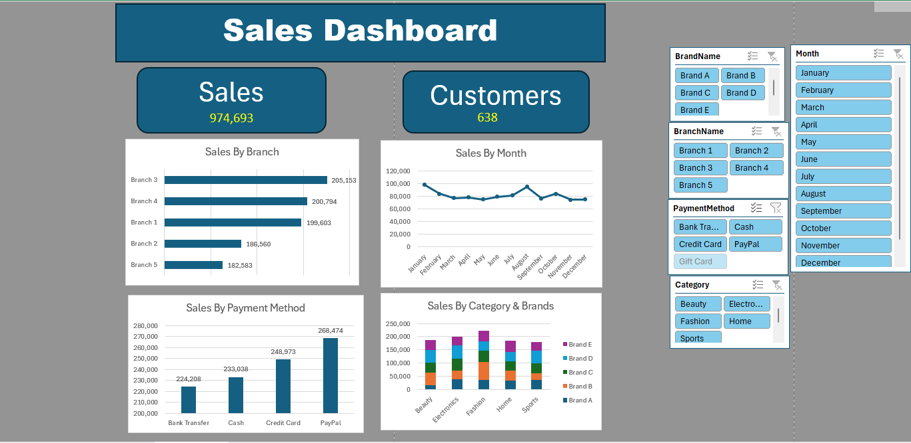
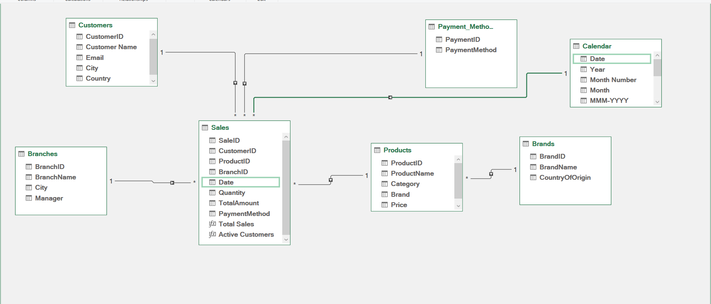
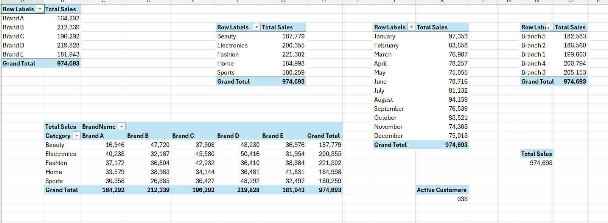

# Excel Sales Analysis

An end-to-end sales analysis built with **Excel Power Query**, **Power Pivot**, **DAX**, **PivotTables**, and an interactive dashboard.

The project combines 2023 and 2024 transaction data with customer, product, brand, branch, and payment-method lookup tables. The Excel workbooks are packaged in [`Excel_WorkBooks.rar`](./Excel_WorkBooks.rar).

## What is included

```text
.
├── Excel_WorkBooks.rar       # Excel source and analysis workbooks
├── README.md
├── Assets/
│   ├── Dashboard.png         # Final dashboard preview
│   ├── Data_Model.png        # Power Pivot relationship diagram
│   └── Pivot_Tables.png      # PivotTable output preview
```

Extract `Excel_WorkBooks.rar` before opening the workbooks or refreshing the queries. The archive contains the completed analysis workbook and the source files used to build it.

## Results

The finished analysis reports:

- Total sales: **974,693**
- Active customers: **638**
- Sales by branch, month, payment method, category, and brand
- Interactive filters for brand, month, branch, payment method, and category

### Dashboard



### Power Pivot data model



### PivotTable outputs



## Requirements

- Microsoft Excel desktop for Windows
- Power Query (`Data > Get & Transform Data`)
- Power Pivot (`Power Pivot > Manage`)
- The Data Model and Power Pivot add-in enabled:
  - Go to `File > Options > Add-ins`.
  - At the bottom, choose `COM Add-ins`, select `Microsoft Power Pivot for Excel`, and choose `Go`.
- Keep the extracted source files in the same relative structure as the workbook if you want to refresh the queries without changing their source paths.

> Excel for the web can display the finished workbook, but the query, model, and PivotTable-building steps require Excel desktop.

## Rebuild the analysis from the source files

The following workflow recreates the project from import through dashboard. The supplied workbooks are packaged in `Excel_WorkBooks.rar`; extract the archive first. Use these steps either to understand the implementation or to reproduce the analysis in a new workbook.

### 1. Create the workbook and import the source data

1. Extract `Excel_WorkBooks.rar`, then open a new blank Excel workbook and save it alongside the extracted source files.
2. Select `Data > Get Data > From File > From Workbook`.
3. Import each lookup workbook:
   - `Branches.xlsx`
   - `Brands.xlsx`
   - `Customers.xlsx`
   - `PaymentMethods.xlsx`
   - `Products.xlsx`
4. Import both transaction workbooks:
   - `Sales 2023.xlsx`
   - `Sales 2024.xlsx`
5. In the Navigator, select the worksheet/table containing the data and choose **Transform Data** rather than loading directly to a worksheet. This opens Power Query for cleanup.

If the files are moved later, update the source step in each query or use `Data > Get Data > Data Source Settings`. Keep the extracted archive contents together so the project remains portable.

### 2. Clean and standardize the queries in Power Query

Apply the following checks to every query:

1. Promote the first row to headers when necessary.
2. Remove blank rows and fully blank columns.
3. Trim and clean text fields.
4. Set stable data types:
   - IDs: whole number or text, consistently within related tables
   - Dates: date
   - Quantity: whole number
   - Price and `TotalAmount`: decimal number or fixed decimal number
   - Names, cities, categories, brands, and payment methods: text
5. Confirm that key columns contain no unexpected nulls or duplicate values in lookup tables.

For the two sales queries, make the column names and data types identical. Then:

1. Select `Home > Append Queries > Append Queries as New`.
2. Append `Sales 2023` and `Sales 2024`.
3. Name the result `Sales`.
4. Keep the original year queries as staging queries, or disable their worksheet load if they are only used by the append query.

Load the lookup queries and the appended `Sales` query with **Only Create Connection** and **Add this data to the Data Model**. Avoid loading large fact data to a worksheet unless you need it for inspection.

### 3. Create a calendar table

Create a dedicated `Calendar` table covering the complete date range in `Sales`. It should contain at least:

| Column | Purpose |
|---|---|
| `Date` | Unique date key |
| `Year` | Year filtering and grouping |
| `Month Number` | Correct chronological month sorting |
| `Month` | Friendly month label |
| `MMM-YYYY` | Month-year display label |

You can create it in Power Query or as a calculated table in Power Pivot. Mark it as the model's date table using `Calendar[Date]`.

### 4. Build the Power Pivot model

Open `Power Pivot > Manage > Diagram View` and create these one-to-many relationships:

| One side (lookup) | Many side (fact) |
|---|---|
| `Branches[BranchID]` | `Sales[BranchID]` |
| `Brands[BrandName]` | `Products[Brand]` |
| `Customers[CustomerID]` | `Sales[CustomerID]` |
| `Payment_Methods[PaymentMethod]` | `Sales[PaymentMethod]` |
| `Products[ProductID]` | `Sales[ProductID]` |
| `Calendar[Date]` | `Sales[Date]` |

Use the actual column names shown in the imported tables when creating relationships. Each lookup key must be unique, and the relationship should filter from the lookup table to `Sales`.

The completed model follows a star-schema pattern:

- `Sales` is the central fact table.
- `Branches`, `Brands`, `Customers`, `Payment_Methods`, `Products`, and `Calendar` are dimensions.
- Measures are created on the `Sales` table and reused by every PivotTable and chart.

### 5. Add DAX measures

In the Power Pivot window, select the `Sales` table and add measures similar to these:

```DAX
Total Sales :=
SUM ( Sales[TotalAmount] )

Active Customers :=
DISTINCTCOUNT ( Sales[CustomerID] )
```

If the source does not contain a reliable `TotalAmount` column, calculate it during Power Query or use the appropriate fact columns:

```DAX
Total Sales :=
SUMX ( Sales, Sales[Quantity] * RELATED ( Products[Price] ) )
```

Use the existing source definition as the authority for the final amount calculation. Format `Total Sales` as a number or currency and `Active Customers` as a whole number.

### 6. Create the PivotTables

Insert each PivotTable from **This Workbook's Data Model**. Suggested layouts matching the supplied result are:

1. **Sales by brand**
   - Rows: `Brands[BrandName]`
   - Values: `[Total Sales]`
2. **Sales by category**
   - Rows: `Products[Category]`
   - Values: `[Total Sales]`
3. **Sales by month**
   - Rows: `Calendar[Month]`
   - Values: `[Total Sales]`
   - Sort by `Calendar[Month Number]`
4. **Sales by branch**
   - Rows: `Branches[BranchName]`
   - Values: `[Total Sales]`
5. **Sales by category and brand**
   - Rows: `Products[Category]`
   - Columns: `Brands[BrandName]`
   - Values: `[Total Sales]`
6. **Sales by payment method**
   - Rows: `Payment_Methods[PaymentMethod]`
   - Values: `[Total Sales]`
7. **KPI values**
   - Values: `[Total Sales]` and `[Active Customers]`

Apply number formatting, meaningful titles, and consistent sorting. Keep the PivotTables on a dedicated `Pivot Tables` sheet, as in the completed workbook.

### 7. Build the dashboard

1. Create a `Dashboard` sheet.
2. Add KPI cards for `[Total Sales]` and `[Active Customers]`.
3. Add PivotCharts for:
   - Sales by branch (bar chart)
   - Sales by month (line chart)
   - Sales by payment method (column chart)
   - Sales by category and brand (stacked column chart)
4. Add slicers for:
   - `Brands[BrandName]`
   - `Calendar[Month]`
   - `Branches[BranchName]`
   - `Payment_Methods[PaymentMethod]`
   - `Products[Category]`
5. Use `Slicer > Report Connections` to connect every slicer to every relevant PivotTable/PivotChart.
6. Align the charts and slicers, apply a consistent color palette, and hide unnecessary gridlines.
7. Add a clear title such as **Sales Dashboard**.

The dashboard should update all KPI cards, tables, and charts when a user selects a slicer value.

## Refresh and validation

After changing any source file:

1. Save the source file in its extracted archive location.
2. Open the completed analysis workbook from the extracted archive.
3. Select `Data > Refresh All`.
4. If the model does not update, refresh the Power Query connections first, then refresh the PivotTables.
5. Confirm that the total sales and customer count reconcile with the source data.
6. Verify that months appear from January through December rather than alphabetically.
7. Select several slicer values and confirm that all connected visuals respond.

Before sharing the workbook, check that:

- No query has an error in Power Query.
- All relationship key columns have matching data types.
- Lookup keys are unique.
- The `Calendar` table covers every sales date.
- The PivotTables and charts show the same totals after refresh.

## Notes

- Do not rename key columns after creating relationships without updating the model.
- If a query path is machine-specific, update it through `Data Source Settings` before distributing the workbook.
- Keep the extracted source files and the completed workbook together when handing the project to another analyst, or share the complete `Excel_WorkBooks.rar` archive.
